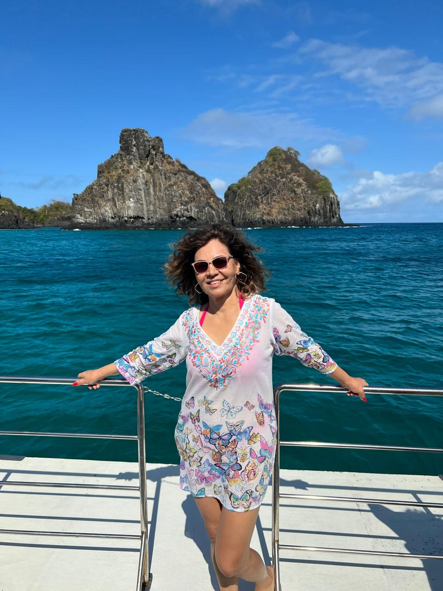
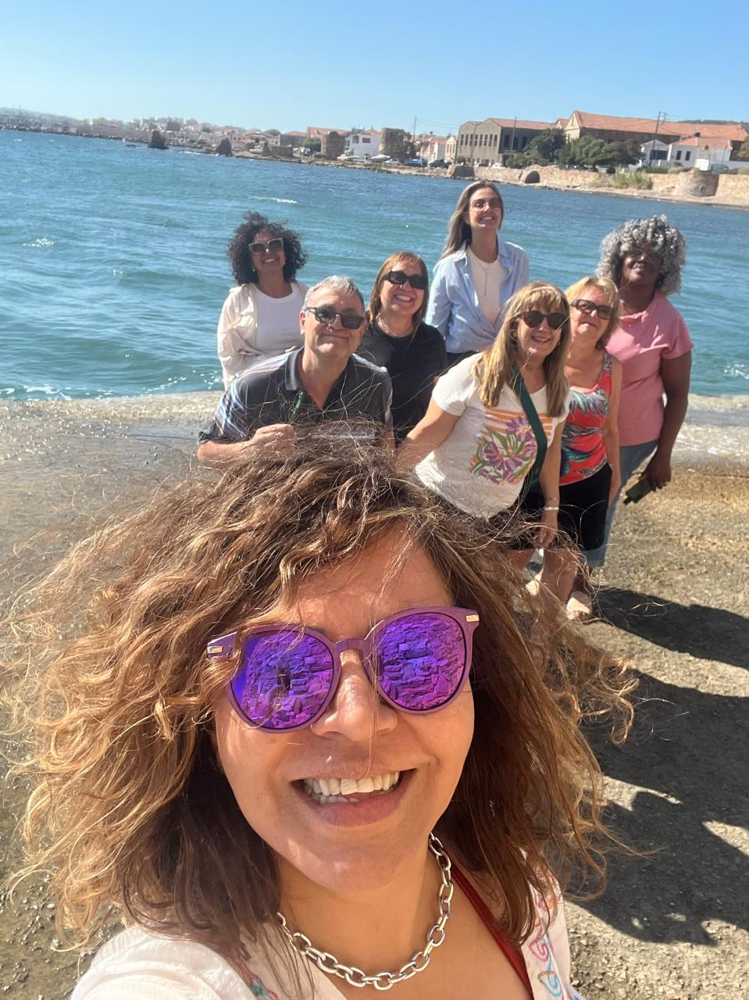
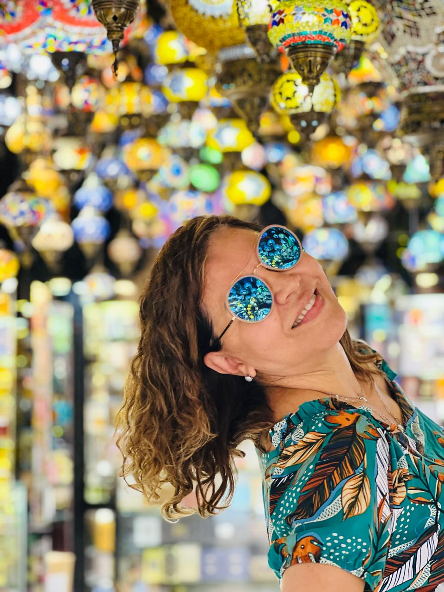

<div align="center">


# 🌍 Taciana Turismos — Consultoria & Roteiros Personalizados

**Plataforma web institucional e portfólio interativo para planejamento de viagens sob medida.**

[]()
[](https://tacianaturismo.com)

</div>

---

## 🎯 Sobre o Projeto

O **Taciana Turismos** (`tacianaturismo.com`) foi desenvolvido como um projeto prático para estruturar a presença digital profissional de uma agente de viagens independente.

O principal objetivo da aplicação é funcionar como uma vitrine de autoridade e um canal direto de captação de clientes, substituindo a venda impessoal de pacotes prontos pela construção de confiança, storytelling e desejo de viagem. A interface traduz o atendimento próximo e humano da profissional em uma experiência digital leve, responsiva e focada em conversão.

### Objetivos Específicos

* **Construção de Autoridade (*Sobre Mim*):** Apresenta a trajetória da profissional (formação em Biologia, atuação na Educação e transição para o Turismo), transmitindo segurança e cuidado no planejamento.
* **Comprovação de Vivência (*Diário de Viagens*):** Portfólio visual com galerias interativas de 15 destinos nacionais e internacionais já vivenciados na prática.
* **Proposta de Valor (*Diferenciais*):** Destaque claro para os 4 pilares do serviço: **Experiência**, **Segurança**, **Atendimento Próximo** e **Personalização**.
* **Prova Social (*Feedback*):** Seção de depoimentos reais para reduzir a objeção de novos clientes.
* **Conversão (*Contato / CTAs*):** Fluxo de navegação guiado para facilitar o contato direto e a solicitação de orçamentos.

---

## 🖼️ Prévia Visual e Exemplos de Funcionamento

### 1. Exemplos do Acervo Visual (Portfólio de Destinos)

O site utiliza fotografias reais registradas pela agente de viagens para comprovar sua experiência nos roteiros recomendados. Abaixo estão alguns exemplos carregados diretamente da pasta `img/` do repositório:

| Fernando de Noronha (Brasil) | Grécia (Europa) | Dubai (Emirados Árabes) |
| :---: | :---: | :---: |
|  |  |  |
| *Roteiros nacionais e ecoturismo* | *Cultura, história e ilhas* | *Experiências internacionais* |

> 💡 **Dica para Prints de Tela:** Caso queira exibir capturas de tela da interface completa (Desktop e Mobile), basta salvar os prints na pasta `img/` (ex: `img/preview-desktop.png` e `img/preview-mobile.png`) e inseri-los aqui usando ``.

---

### 2. Exemplo de Funcionamento (Fluxo de Uso do Visitante)

A navegação foi desenhada como um funil intuitivo de apresentação e conversão:

1. **Boas-vindas e Posicionamento (*Hero Section*):**
   * Ao acessar `tacianaturismo.com`, o visitante visualiza a proposta de consultoria personalizada e tem acesso imediato aos botões de ação (*"Explore meus destinos"* e *"Vamos conversar"*).
2. **Exploração Interativa (*Diário de Viagens*):**
   * O usuário navega pelos cards dos 15 destinos disponíveis.
   * **Ação:** Ao clicar em um destino (como *Chile*, *Pamukkale*, *Istambul* ou *Lençóis Maranhenses*), o script `js/main.js` consulta os dados em `js/destinations.js` e abre uma **galeria interativa (modal)** exibindo múltiplas fotos e detalhes daquela viagem.
3. **Validação de Confiança (*Sobre Mim, Diferenciais e Depoimentos*):**
   * Descendo a página, o cliente conhece a história da Taciana, entende os 4 pilares do atendimento e lê relatos reais de viajantes acompanhados por ela.
4. **Solicitação de Orçamento (*Conversão*):**
   * Convencido do diferencial do serviço, o visitante clica nos botões de contato para iniciar uma conversa direta com a agente e solicitar seu roteiro sob medida.

---

### 3. Exemplo Prático no Código (Cadastro de Destinos)

Para facilitar a manutenção do site sem precisar alterar a estrutura HTML principal, os dados dos destinos e suas respectivas fotos são organizados em JavaScript (`js/destinations.js`). Exemplo de estrutura utilizada para alimentar a galeria:

```javascript
// Exemplo de estrutura para adicionar ou atualizar um destino em js/destinations.js
const novoDestino = {
  id: "noronha",
  titulo: "Fernando de Noronha - PE",
  categoria: "Nacional",
  descricao: "Roteiro personalizado com passeios de barco, trilhas e dicas exclusivas.",
  imagens: [
    "img/noronha.jpeg",
    "img/noronha1.jpeg",
    "img/noronha2.jpeg",
    "img/noronha3.jpeg"
  ]
};
```

---

## ✨ Funcionalidades e Seções

* [x] **Hero Section Estratégica:** Chamada principal com foco em consultoria personalizada e botões de ação rápida (*CTAs*).
* [x] **Galeria Interativa de Destinos:** Exibição de 15 roteiros nacionais e internacionais (como Chile, Milão, Grécia, Dubai, Lisboa, Lençóis Maranhenses, Madrid, Fernando de Noronha, Abu Dhabi, Pamukkale, Istambul e Aracaju) com visualização ampliada de fotos.
* [x] **Seção Institucional & Diferenciais:** Cards informativos destacando os benefícios da consultoria sob medida.
* [x] **Depoimentos de Clientes (*Experiências Reais*):** Relatos de viajantes acompanhados antes, durante e após a viagem.
* [x] **Integração de Contato Direto:** Redirecionamento otimizado para atendimento personalizado via canais diretos da agente.
* [x] **Design Responsivo (*Mobile-First*):** Layout adaptado para smartphones, tablets e desktops.

---

## 🛠️ Tecnologias Utilizadas

* **Estrutura:** HTML5 Semântico
* **Estilização & Layout:** CSS3 (Flexbox, Grid, animações e media queries)
* **Interatividade & Dados:** JavaScript (Vanilla JS / ES6+)
* **Hospedagem & Domínio:** [HostGator](https://www.hostgator.com.br/)
* **Versionamento:** Git & GitHub

---

## 📁 Estrutura de Pastas

```text
Taciana-Turismo/
├── index.html              # Página principal e estrutura das seções
├── css/
│   └── style.css           # Folha de estilos, paleta de cores e responsividade
├── js/
│   ├── destinations.js     # Base de dados dos 15 destinos e galerias de fotos
│   └── main.js             # Scripts de interatividade, modais e navegação
├── img/                    # Acervo de imagens (logos, retratos, destinos e depoimentos)
├── mp4/
│   └── chile1.mp4          # Mídia em vídeo integrada à experiência visual
└── README.md               # Documentação do projeto
```

---

## 📋 Requisitos e Dependências

Por ter sido construído integralmente com tecnologias web nativas (**HTML5, CSS3 e JavaScript puro**), o projeto **não possui dependências de pacotes externos** (não requer instalação de *Node.js*, *npm* ou frameworks para funcionar).

### Requisitos para Ambiente Local (Desenvolvimento)

* **Navegador Web atualizado:** Google Chrome, Mozilla Firefox, Microsoft Edge ou Safari.
* **Git** (opcional, caso deseje clonar o repositório via terminal).
* **Editor de Código** (recomendado: [Visual Studio Code](https://code.visualstudio.com/) com a extensão **Live Server**).
* **Conexão com a Internet:** Necessária apenas para o carregamento de fontes externas e redirecionamento dos links de contato.

### Requisitos para Ambiente de Produção (Deploy)

* Qualquer serviço de hospedagem estática ou compartilhada (atualmente hospedado na **HostGator** com certificado SSL ativo em `https://tacianaturismo.com`).

---

## 🚀 Instalação, Configuração e Execução

### 1. Instalação (Clonando o Repositório)

Abra o terminal de sua preferência e execute os comandos abaixo para baixar o projeto:

```bash
# Clone o repositório oficial
git clone https://github.com/raullSantoss/Taciana-Turismo.git

# Acesse a pasta do projeto
cd Taciana-Turismo
```

*(Alternativamente, você pode clicar em **`<> Code` > `Download ZIP`** na página do repositório e extrair os arquivos em uma pasta local).*

### 2. Configuração e Personalização

Caso precise atualizar conteúdos, imagens ou links de atendimento antes de publicar:

* **Adicionar ou editar destinos e galerias:** Edite o arquivo `js/destinations.js` e adicione as respectivas fotografias otimizadas na pasta `img/`.
* **Atualizar textos institucionais e links de contato:** Edite diretamente no arquivo `index.html` (seções *Sobre mim*, *Diferenciais*, *Experiências reais* e botões de *CTA*).
* **Ajustar estilos visuais:** Modifique as regras e variáveis no arquivo `css/style.css`.

### 3. Execução Local

Você pode visualizar o site localmente de duas maneiras:

* **Opção A — Usando o VS Code + Live Server (Recomendado):**
  1. Abra a pasta `Taciana-Turismo` no **VS Code**.
  2. Clique com o botão direito sobre o arquivo `index.html`.
  3. Selecione **`Open with Live Server`**.
  4. O projeto abrirá automaticamente em `http://127.0.0.1:5500/index.html` com atualização automática a cada alteração salva.

* **Opção B — Abertura direta no navegador:**
  1. Navegue até a pasta onde o projeto foi baixado.
  2. Dê um duplo clique no arquivo `index.html` para abri-lo no seu navegador padrão.

### 4. Deploy (Publicação em Produção)

Para atualizar a versão online no domínio `tacianaturismo.com`:

1. Acesse o painel de controle da hospedagem (**cPanel** na HostGator).
2. Abra o **Gerenciador de Arquivos** e navegue até o diretório raiz `public_html/`.
3. Envie os arquivos atualizados (`index.html` e as pastas `css/`, `js/`, `img/` e `mp4/`) mantendo a mesma hierarquia de diretórios.

---

## 👥 Equipe de Desenvolvimento

Projeto desenvolvido em grupo para cliente real:

| Integrante | Função no Projeto | GitHub |
| :--- | :--- | :--- |
| **Daniel Medeiros Ribeiro** | `[Ex: Front-end & Hospedagem]` | [@danielmrib](https://github.com/danielmrib) |
| **Raul Toffoletto dos Santos** | `[Ex: Contato com Cliente & Front-Back-End]` | [@raullSantoss](https://github.com/raullSantoss) |
| **Pedro Henrique Piacentini Mateus** | `[Ex: Front-End & Back-End]` | [@usuario3](https://github.com/) |
